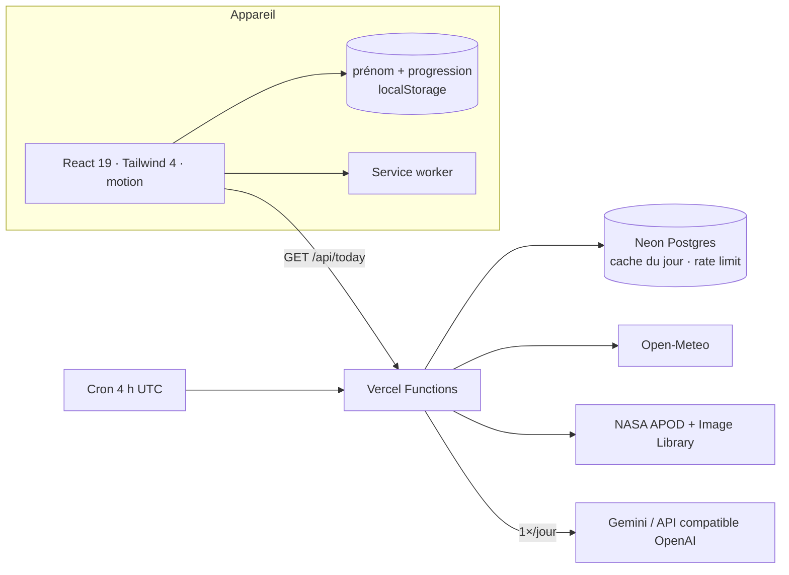

<div align="center">


# Pulse Kids

**Contes, activités, vidéos et explications animées pour les enfants de 5 à 8 ans.**
Simple, joyeux, personnalisé avec le prénom de l’enfant — sans publicité, sans compte, même hors ligne.
Un mode d’âge (🐣 5–6 ans / 🦊 7–8 ans) adapte la longueur des textes, la vitesse de la voix et les compléments d’explication.

[🌐 Ouvrir l’app](https://pulse-kids-main.vercel.app/) · [🐛 Signaler un bug](https://github.com/Miyagi1017/pulse-kids/issues)


</div>

---

## ✨ L’app en 5 boutons

| | | |
|---|---|---|
| 🎬 | **La vidéo du jour + 50 vidéos** | 50 mini-documentaires narrés (animaux, nature, espace, métiers, corps, monde), chacun avec **une vraie photo** sous licence libre, à regarder **à la suite** (enchaînement automatique). Chaque vidéo finit par une **question flash** (3 gros boutons) puis **l’explication de la réponse**. Le journal du jour : Un petit dessin animé narré et sous-titré, construit chaque jour à partir des vraies infos : date, saison, **météo en direct**, **photo NASA**, anecdote « Le savais-tu ? » et thème écrit par l’IA |
| 💡 | **12 explications animées** | « Pourquoi le ciel est bleu ? », « Comment pousse une graine ? »… Chaque grande question est racontée en **3 étapes dessinées et animées** (SVG, aucun téléchargement), puis vérifiée par **une question de compréhension**. Une **petite expérience** à refaire à la maison termine chaque explication. |
| 🎵 | **1 chanson animée, 2 thèmes** | « Nino et Nina rangent leurs jouets » : un épisode vidéo de 24 s, **fabriqué en local** (dessins vectoriels, musique procédurale, voix française), avec les paroles qui s’allument en karaoké, une question et une mission à refaire. Deux versions : **rose** (thèmes fille et kawaii) et **bleue** (thème garçon). Le pipeline est dans `scripts/chansons/`. |
| 📖 | **226 contes** | 26 grands classiques et 200 contes Pulse Kids, page par page, lus à voix haute, **illustrés et animés** (zoom lent, particules selon le sujet) |
| 🧩 | **270 activités** | 50 jeux classiques (devinettes, compter, trouve l’intrus) **+ 60 jeux d’apprentissage** mélangés (🗣️ langue · 💛 savoir-être · 🙏 savoir-vivre · 🤖 découvrir l’IA · ⏰ discipline) **+ 160 jeux interactifs** — avec « Oui ou non ? » et « Remets dans l’ordre », jouables sans savoir lire |
| 🌙 | **200 contes du soir** | Fond étoilé, voix lente, fin apaisante et petite berceuse |

- 👶 **Adapté à l’âge** : 🐣 5–6 ans (phrases courtes, voix très lente, texte en gros caractères) ou 🦊 7–8 ans (compléments « pour aller plus loin », voix un peu plus rapide). Le mode se change en un geste depuis l’accueil, ou à tout moment via « Changer d’âge ».
- 👋 **Personnalisé** : le prénom choisi au premier lancement apparaît dans les contes, la vidéo et les félicitations. Il reste **sur l’appareil**, il n’est jamais envoyé au serveur.
- ✓ Une petite coche marque ce qui a déjà été lu, réussi ou compris ; le bouton **Surprise !** propose un contenu pas encore découvert.
- 🎲 Les activités sont **mélangées** (jamais 3 du même thème d’affilée) ; des pastilles permettent de filtrer par thème.
- 🎬 Le lecteur vidéo est pilotable : scènes cliquables, « Réécouter », gros texte (bouton **Aa**), raccourcis clavier ← → / espace / R.
- 🎵 La chanson se lit en karaoké : paroles synchronisées sur la voix, lignes cliquables pour revenir en arrière, quiz à la fin. La vidéo suit le thème choisi (rose ou bleue) ; les MP4 et leurs sous-titres sont fournis pour YouTube.
- ✈️ **Hors ligne** : tous les contenus sont embarqués ; la vidéo du jour a une version sans réseau.
- ♿ Gros boutons, tout est dit à voix haute, respect du réglage « réduire les animations ».

## 🏗️ Architecture



```
src/data/            226 contes · 200 contes du soir · 270 activités · 12 explications · 1 chanson (+ tests)
src/components/      Accueil, bibliothèques, contes, activités, vidéos, explications animées, lecteur de chanson
src/lib/             Profil (prénom + âge), vidéo du jour (cache + version hors ligne), playlist
shared/              Schémas zod + contenus du jour calculés (saison, anecdotes)
server/              IA multi-fournisseurs, NASA, météo, cache, rate-limit
api/                 today · health · cron/daily
scripts/chansons/    Pipeline local : dessins SVG → images → MP4 + musique + voix + sous-titres
```

## 💚 100 % open source

| Brique | Projet | Licence |
|---|---|---|
| Interface | React, Vite, Tailwind CSS, motion, lucide, canvas-confetti, tw-animate-css | MIT / ISC |
| Validation | zod | MIT |
| Police | Fredoka (via Fontsource) | SIL OFL 1.1 |
| Base de données | Neon / Lakebase Postgres, driver `@neondatabase/serverless` | Apache 2.0 / MIT |
| Illustrations des contes | **FLUX.1-schnell** via le Space officiel Hugging Face (client Gradio), compressées avec sharp | Apache 2.0 |
| Thème du jour (IA) | **gpt-oss-20b** via Hugging Face (ou tout modèle ouvert : Qwen, Llama via Ollama…) | Apache 2.0 |
| Météo | Open-Meteo | AGPL (données CC BY 4.0) |
| Photos de l’espace | NASA APOD & Image Library | Domaine public |
| Photos des 50 vidéos | **Openverse** (moteur open source, fondation WordPress) + NASA, relues une à une, crédits dans `src/data/videoCredits.json` | CC0, domaine public, CC BY, CC BY-SA |
| Synthèse vocale | Web Speech API du navigateur | Standard W3C |
| Chansons animées | SVG maison + `sharp` + `ffmpeg` + `numpy` + voix Windows SAPI | Contenus originaux (MIT) |

Les illustrations sont générées **une seule fois** puis embarquées : l’enfant n’appelle jamais de service d’IA. Chaque image passe par une **relecture humaine** avant publication :

```bash
npm run illustrations                           # Hugging Face (quota gratuit quotidien) → file d’attente
npm run illustrations -- --source=pollinations   # option Pollinations.ai (compte requis, qualité variable)
npm run illustrations:review                    # planche-contact à relire
npm run illustrations:publish -- --reject=conte-05   # publie, sauf les images refusées
```

`src/assets/illustrations/sources.json` garde l’origine de chaque image. Une tâche planifiée génère chaque jour les images manquantes avec le quota gratuit Hugging Face ; tant qu’un conte n’a pas d’illustration, il s’affiche avec son emoji animé et ses particules d’ambiance. Gemini reste possible mais uniquement en dernier recours, si aucun fournisseur ouvert n’est configuré.

## 🎵 Fabriquer une chanson animée

L’épisode « Nino et Nina rangent leurs jouets » (24 s, en version rose et version bleue) est **entièrement reproductible sans réseau** :

```powershell
powershell -ExecutionPolicy Bypass -File scripts/chansons/build.ps1
```

Le pipeline enchaîne : dessins vectoriels et palettes (`art.mjs`) → storyboard et caméra (`timeline.mjs`) → images
(`sharp`) → musique procédurale et mixage (`numpy`) → voix française Windows (SAPI) → encodage `ffmpeg`,
plus l’affiche et les **sous-titres SRT** pour YouTube. Chaque étape peut être remplacée par de l’IA
open source (FLUX + LoRA pour les personnages, Wan/HunyuanVideo pour l’image→vidéo, Piper/XTTS pour la
voix, ACE-Step pour la musique, LatentSync pour le lip-sync) : le mode d’emploi est dans
`scripts/chansons/README.md`.

## 🔐 Sécurité & vie privée

- **Aucune donnée personnelle côté serveur** : pas de compte ; le prénom et l’âge restent dans `localStorage` et ne sont jamais envoyés (le prénom est inséré localement via `{p}`, l’âge ne sert qu’à choisir un texte et une vitesse de voix).
- **Contenu IA filtré** : schéma zod strict (HTML et liens interdits, longueurs bornées), prompt avec règles pour les 5 ans, revalidé côté appareil.
- **Explications et quiz 100 % statiques** : écrits et relus dans le dépôt, testés (longueurs, réponses, mots interdits) — aucune génération d’IA au moment où l’enfant les regarde.
- **CSP stricte** (aucun script tiers, images limitées à la NASA), HSTS, `X-Frame-Options: DENY`, `Permissions-Policy`.
- Requêtes SQL paramétrées, limitation de débit par IP, erreurs génériques, secrets uniquement dans Vercel.
- Polices auto-hébergées : aucun appel à un service tiers depuis l’appareil.

## 🚀 Démarrer

```bash
git clone https://github.com/Miyagi1017/pulse-kids.git
cd pulse-kids
npm install
npm run dev          # http://localhost:3000
```

Tout fonctionne sans configuration. Options (voir `.env.example`) :

| Variable | Active |
|---|---|
| `DATABASE_URL` | Cache partagé du jour + limitation de débit (Neon : `neon init && neon deploy`, puis `npm run db:migrate`) |
| `HF_TOKEN` | Illustrations (`npm run illustrations`) + thème du jour avec un modèle ouvert Hugging Face |
| `AI_BASE_URL` + `AI_MODEL` (+ `AI_API_KEY`) | Autre fournisseur compatible OpenAI (Ollama local, Groq, OpenRouter…) |
| `GEMINI_API_KEY` | Gemini (propriétaire), en dernier recours |
| `NASA_API_KEY` | Clé NASA perso (sinon `DEMO_KEY` puis la bibliothèque d’images sans clé) |
| `CRON_SECRET` | Protège la tâche planifiée |

| Commande | Rôle |
|---|---|
| `npm run dev` | Front + API en local |
| `npm run check` | Typecheck + tests + build |
| `npm run db:migrate` | Crée les tables Neon |
| `npm run illustrations` | Génère les illustrations manquantes (FLUX.1-schnell) |
| `npm run video-images` | Cherche les photos des vidéos sur Openverse (`-- review` / `-- publish --reject=…`) |

## 🚢 Déploiement

Le dépôt est connecté à Vercel : **chaque push sur `main` part en production**, chaque autre branche ou pull request reçoit une URL de preview.

## 📄 Licence

MIT — fait avec ❤️ pour les p’tits curieux.
