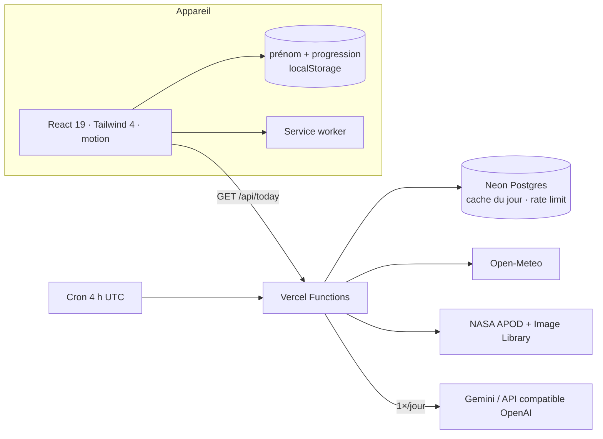

<div align="center">


# Pulse Kids

**Contes, petites activités et vidéo du jour pour les enfants de 5 ans.**
Simple, joyeux, personnalisé avec le prénom de l’enfant — sans publicité, sans compte, même hors ligne.

[🌐 Ouvrir l’app](https://pulse-kids-main.vercel.app/) · [🐛 Signaler un bug](https://github.com/Miyagi1017/pulse-kids/issues)


</div>

---

## ✨ L’app en 4 boutons

| | | |
|---|---|---|
| 🎬 | **La vidéo du jour** | Un petit dessin animé narré et sous-titré, construit chaque jour à partir des vraies infos : date, saison, **météo en direct**, **photo NASA**, anecdote « Le savais-tu ? » et thème écrit par l’IA |
| 📖 | **50 contes** | Histoires de journée, page par page, lues à voix haute |
| 🧩 | **110 activités** | 50 jeux classiques (devinettes, compter, trouve l’intrus) **+ 60 jeux d’apprentissage** mélangés : 🗣️ langue · 💛 savoir-être · 🙏 savoir-vivre · 🤖 découvrir l’IA · ⏰ discipline — avec « Oui ou non ? » et « Remets dans l’ordre », jouables sans savoir lire |
| 🌙 | **50 contes du soir** | Fond étoilé, voix lente, fin apaisante et petite berceuse |

- 👋 **Personnalisé** : le prénom choisi au premier lancement apparaît dans les contes, la vidéo et les félicitations. Il reste **sur l’appareil**, il n’est jamais envoyé au serveur.
- ✓ Une petite coche marque ce qui a déjà été lu ou réussi ; le bouton **Surprise !** propose un contenu pas encore découvert.
- 🎲 Les activités sont **mélangées** (jamais 3 du même thème d’affilée) ; des pastilles permettent de filtrer par thème.
- ✈️ **Hors ligne** : les 210 contenus sont embarqués ; la vidéo du jour a une version sans réseau.
- ♿ Gros boutons, tout est dit à voix haute, respect du réglage « réduire les animations ».

## 🏗️ Architecture



```
src/data/            50 contes · 50 contes du soir · 50 activités + 60 jeux d’apprentissage (+ tests)
src/components/      Accueil, bibliothèque, lecteur de contes, activités, vidéo du jour
src/lib/             Profil (prénom), vidéo du jour (cache + version hors ligne)
shared/              Schémas zod + contenus du jour calculés (saison, anecdotes)
server/              IA multi-fournisseurs, NASA, météo, cache, rate-limit
api/                 today · health · cron/daily
```

## 🔐 Sécurité & vie privée

- **Aucune donnée personnelle côté serveur** : pas de compte ; le prénom est inséré localement (`{p}` dans les textes).
- **Contenu IA filtré** : schéma zod strict (HTML et liens interdits, longueurs bornées), prompt avec règles pour les 5 ans, revalidé côté appareil.
- **CSP stricte** (aucun script tiers, images limitées à la NASA), HSTS, `X-Frame-Options: DENY`, `Permissions-Policy`.
- Requêtes SQL paramétrées, limitation de débit par IP, erreurs génériques, secrets uniquement dans Vercel.
- Polices auto-hébergées : aucun appel à un service tiers depuis l’appareil.

## 🚀 Démarrer

```bash
git clone https://github.com/Miyagi1017/pulse-kids.git
cd pulse-kids
npm install
npm run dev          # http://localhost:3000
```

Tout fonctionne sans configuration. Options (voir `.env.example`) :

| Variable | Active |
|---|---|
| `DATABASE_URL` | Cache partagé du jour + limitation de débit (Neon : `neon init && neon deploy`, puis `npm run db:migrate`) |
| `GEMINI_API_KEY` **ou** `AI_BASE_URL` + `AI_MODEL` (+ `AI_API_KEY`) | Thème du jour écrit par l’IA (Gemini, Groq, OpenRouter, Mistral, Ollama…) |
| `NASA_API_KEY` | Clé NASA perso (sinon `DEMO_KEY` puis la bibliothèque d’images sans clé) |
| `CRON_SECRET` | Protège la tâche planifiée |

| Commande | Rôle |
|---|---|
| `npm run dev` | Front + API en local |
| `npm run check` | Typecheck + tests + build |
| `npm run db:migrate` | Crée les tables Neon |

## 🚢 Déploiement

Le dépôt est connecté à Vercel : **chaque push sur `main` part en production**, chaque autre branche ou pull request reçoit une URL de preview.

## 📄 Licence

MIT — fait avec ❤️ pour les p’tits curieux.
