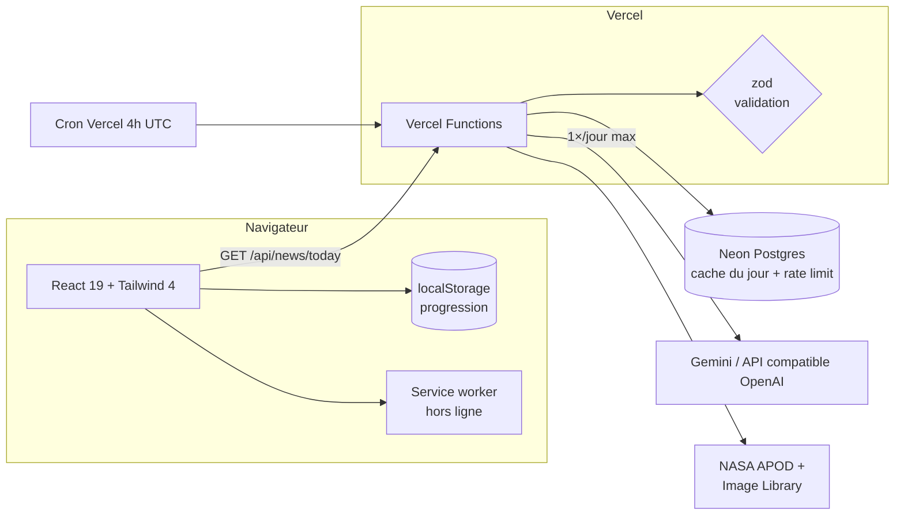

<div align="center">


# Pulse Kids

**Le journal animé des p’tits curieux.**
Chaque jour, une actualité positive racontée en dessin animé interactif pour les enfants de 5 ans.

[🌐 Démo en ligne](https://pulse-kids-main.vercel.app/) · [🐛 Signaler un bug](https://github.com/Miyagi1017/pulse-kids/issues)


</div>

---

## ✨ Ce que fait l’app

| | |
|---|---|
| 🎬 **5 missions par jour** | Dessin animé interactif, quiz sonore, animaux, bulle mystère, conte du soir |
| 🗣️ **Lecture à voix haute** | Synthèse vocale française au rythme d’un enfant, mots touchables avec syllabes |
| ⭐ **Étoiles & badges** | 5 étoiles par jour, 8 badges à collectionner, confettis et fanfare |
| 🤖 **Édition du jour par IA** | Gemini **ou toute API compatible OpenAI** (Groq, OpenRouter, Mistral, Ollama…) — validée, filtrée, mise en cache |
| 🔭 **Photo de l’espace du jour** | Vraie photo NASA (domaine public) avec une légende écrite pour les 5 ans, à écouter |
| ✨ **Animations** | Cartes qui apparaissent, « boing » de victoire, étoiles animées — respecte « réduire les animations » |
| 📅 **Une histoire différente chaque jour** | Même sans IA ni internet, la bibliothèque tourne selon la date |
| ✈️ **Vrai mode hors ligne** | Service worker : l’app s’ouvre et fonctionne sans internet, détection automatique |
| 🚫 **Zéro pub, zéro traceur, zéro compte** | Aucune donnée personnelle collectée, la progression reste sur l’appareil |

## 🏗️ Architecture



```
api/
  news/today.ts      Édition du jour (cache base + CDN, limitation de débit)
  space/today.ts     Photo NASA du jour
  cron/daily.ts      Préparation du contenu chaque matin + ménage
  health.ts          État du service (base, IA)
server/              Back-end : SQL, cache, rate-limit, IA multi-fournisseurs, NASA
shared/schemas.ts    Schéma zod de l’édition, partagé front ↔ back
db/schema.sql        Schéma Postgres (idempotent)
src/                 Front React (composants, services, utilitaires)
public/sw.js         Service worker (mode hors ligne)
```

L’app est **progressive** : sans base de données ni clé IA, elle fonctionne entièrement avec ses histoires embarquées. Chaque brique s’active dès que sa variable d’environnement est présente.

## 🔐 Sécurité

| Risque | Protection |
|---|---|
| Contenu IA inadapté ou malveillant | Prompt avec règles strictes pour 5 ans + validation **zod** de chaque champ (HTML interdit, longueurs bornées, une seule bonne réponse au quiz) côté serveur **et** côté client |
| XSS | Rendu React échappé, **Content-Security-Policy** stricte : aucun script tiers, aucun `eval` |
| Images externes | Seules les images `https` de la NASA sont acceptées (validation serveur + client + CSP `img-src`) |
| Abus / coût de l’API IA | Gemini appelé 1 fois par jour au maximum (cache Postgres + mémoire + CDN), limitation de débit par IP |
| Injection SQL | Requêtes 100 % paramétrées (`@neondatabase/serverless`) |
| CSRF | Vérification d’origine sur toute requête modifiante |
| Clickjacking & co | `X-Frame-Options: DENY`, HSTS, `nosniff`, `Referrer-Policy`, `Permissions-Policy` (caméra / micro / géolocalisation bloqués) |
| Fuite d’erreurs | Messages génériques, aucune stack trace renvoyée au client |
| Vie privée (RGPD enfants) | Aucun compte, aucune donnée personnelle, aucun traceur ; les anciennes données locales sont purgées |
| Secrets | Clés uniquement côté serveur (variables Vercel), jamais dans le bundle |

## 🚀 Démarrer

```bash
git clone https://github.com/Miyagi1017/pulse-kids.git
cd pulse-kids
npm install
npm run dev          # http://localhost:3000
```

Les routes `/api` tournent en local via un petit plugin Vite qui exécute **les mêmes fichiers** que Vercel.

### Activer la base de données et l’IA (optionnel)

```bash
npx vercel link                       # lier le projet Vercel
neon init && neon deploy              # créer la base Neon Postgres (offre gratuite)
npx vercel env add GEMINI_API_KEY     # ou AI_BASE_URL + AI_MODEL + AI_API_KEY (voir .env.example)
npx vercel env pull .env.local        # récupérer les variables en local
npm run db:migrate                    # créer les tables
```

### Scripts

| Commande | Rôle |
|---|---|
| `npm run dev` | Front + API en local avec rechargement à chaud |
| `npm run check` | Typecheck + tests + build (à lancer avant chaque push) |
| `npm test` | Tests unitaires (étoiles & badges, validation du contenu) |
| `npm run db:migrate` | Applique `db/schema.sql` |

## 🚢 Déploiement

Le dépôt est connecté à Vercel : le déploiement est **automatique**.

| Action | Résultat |
|---|---|
| Push sur `main` | Mise en production sur [pulse-kids-main.vercel.app](https://pulse-kids-main.vercel.app/) |
| Push sur une autre branche / pull request | URL de preview pour tester avant de fusionner |

Pensez à lancer `npm run check` avant de pousser.

## 🧭 API

| Méthode | Route | Description |
|---|---|---|
| `GET` | `/api/news/today` | Édition du jour validée (`{ story }`, ou `{ fallback: true }`) |
| `GET` | `/api/space/today` | Photo de l’espace du jour (`{ photo }`) |
| `GET` | `/api/cron/daily` | Tâche planifiée (`CRON_SECRET` si défini) |
| `GET` | `/api/health` | État du service, de la base et de l’IA |

## 🗺️ Pistes

- [ ] Illustrations animées SVG pour chaque scène
- [ ] Archives des éditions passées
- [ ] Quiz sur la photo de l’espace
- [ ] Tests end-to-end Playwright

## 📄 Licence

MIT — fait avec ❤️ pour les p’tits curieux.
